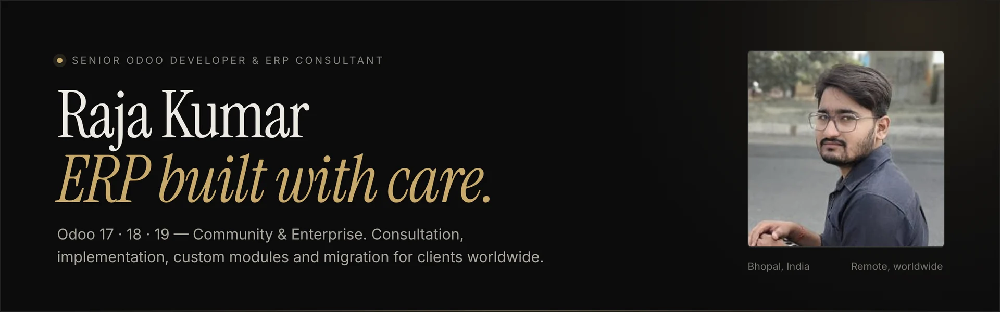
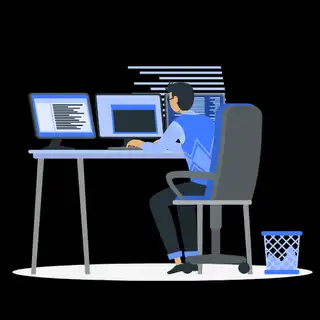
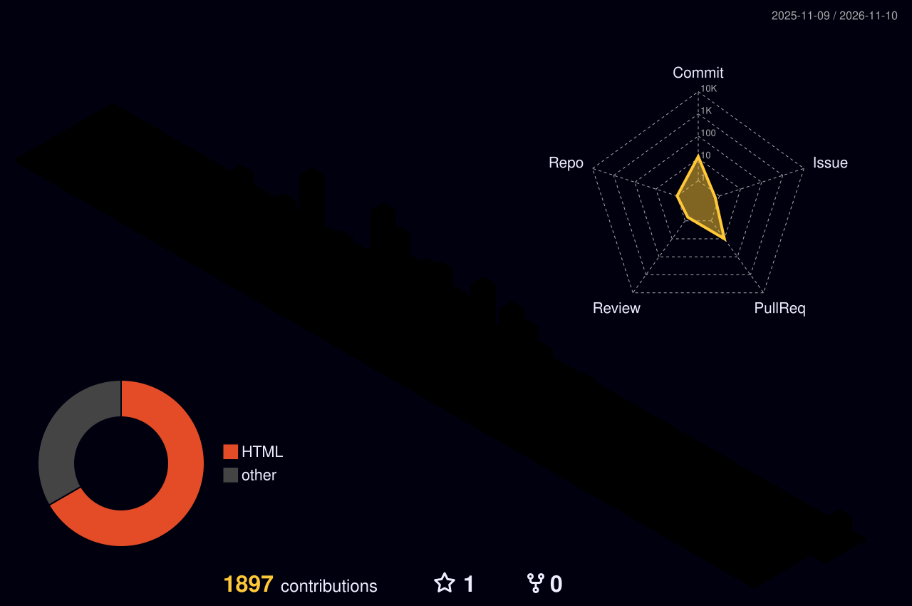

# 
🚀 Hi there! I'm Raja Kumar — Odoo Developer &amp; ERP Consultant 👋

<b>Senior Odoo developer for Odoo 17, 18 and 19 (Community &amp; Enterprise)</b> · Odoo implementation, customization, migration and Odoo.sh hosting · Remote for clients worldwide

  

  

  
  <!-- Animated Location & Role -->
  
  
  <!-- Glowing Badges -->
  
  
  
  

  
  <!-- Matrix-style animated stats -->
  

  
  

  

  
  
  
  

---

### About

I'm a **Senior Odoo Developer & ERP Consultant** who helps businesses get Odoo right: set up properly, built around how they actually work, and supported after go-live.

Over **10+ ERP projects** in India, the Middle East and Europe I've delivered **100+ custom Odoo modules**, from CRM automation and accounting reports to multi-company setups, customer portals and webshops. I work remotely with clients worldwide, directly and without agency overhead, typically at **up to 75% lower cost** than traditional ERP partners.

- **Now** — Senior Odoo Developer & ERP Administrator at **Strohm Energy**, running Odoo 19 Enterprise across a 7-company solar energy group
- **Building** — MYSTOVIO, a lead-to-project platform for solar installers, and an Odoo-native solar design & proposal system
- **Based in** — Bhopal, India · working in your time zone

---

### What I do

| | |
|:--|:--|
| **Odoo consultation** | Requirement analysis, process mapping and a clear rollout plan, Community or Enterprise |
| **ERP setup & implementation** | Sales, CRM, Inventory, Accounting, Manufacturing, HR, Projects, Website — single or multi-company |
| **Custom module development** | Python, OWL/JavaScript and QWeb modules that fit your exact workflow |
| **Data migration** | Zoho CRM & Books → Odoo, spreadsheets, legacy ERPs and version upgrades, with zero data loss |
| **Hosting & DevOps** | Odoo Online, Odoo.sh or your own server; staging, production and automated off-site backups |
| **Integrations & AI** | WhatsApp, Meta Lead Ads, payment gateways, Google Maps, IoT and Claude/MCP connected to Odoo |

---

### Hire an Odoo developer

Looking for an **Odoo developer**, **Odoo consultant** or **Odoo implementation partner** without agency overhead? I work directly with companies and Odoo partners to plan, build and support Odoo ERP — from a first Odoo setup to complex custom modules and migrations.

<table>
<tr>
<td valign="top" width="50%">

**Odoo apps I implement & customize**
- Odoo CRM &amp; Sales
- Odoo Inventory, Purchase &amp; Barcode
- Odoo Accounting &amp; Invoicing
- Odoo Manufacturing (MRP)
- Odoo HR, Attendance &amp; Fleet
- Odoo Website, eCommerce &amp; Portal
- Odoo Project &amp; Timesheets

</td>
<td valign="top" width="50%">

**Typical Odoo projects**
- New Odoo ERP implementation (Community or Enterprise)
- Custom Odoo module development (Python, OWL, QWeb)
- Odoo migration &amp; upgrade (Odoo 15/16/17 → 18/19)
- Zoho, spreadsheet &amp; legacy ERP → Odoo data migration
- Odoo API, webhook, payment &amp; WhatsApp integrations
- Odoo.sh / Docker hosting, backups &amp; performance tuning

</td>
</tr>
</table>

**Industries:** solar &amp; energy · manufacturing · distribution &amp; wholesale · travel &amp; logistics · education · real estate · services
**Regions:** India · UAE &amp; Saudi Arabia · Europe (Belgium, Germany) · United States · Australia — remote, in your time zone

<b>FAQ — hiring a freelance Odoo developer</b>

**Do you work with Odoo Community and Odoo Enterprise?**
Yes — Odoo 17, 18 and 19 in both editions, on Odoo Online, Odoo.sh or your own server.

**Can you join an existing Odoo project or help an Odoo partner?**
Yes. I can pick up existing codebases, fix bugs, upgrade modules and add features.

**Can you migrate our data to Odoo?**
Yes — including a Zoho CRM &amp; Zoho Books → Odoo 19 migration of 100K+ records with zero data loss.

**How much does an Odoo developer cost?**
Working directly with me is typically up to 75% cheaper than a traditional ERP partner. Share your scope for a quote.

**How do we start?**
Email [rajakumar829891@gmail.com](mailto:rajakumar829891@gmail.com) or message me on [LinkedIn](https://www.linkedin.com/in/raja-kumar-cseaiml) with a short description of your Odoo project.

---

### Selected work

| Project | What it does | Outcome |
|:--|:--|:--|
| **Meta Lead Ads & WhatsApp ingestion** | Event-driven webhooks with HMAC-SHA256 verification and an OWL chat view inside CRM | Lead capture under 2 seconds |
| **Zoho → Odoo 19 migration** | Field mapping, schema reconciliation and validation hooks | 100K+ records, zero data loss |
| **Odoo ↔ Claude MCP server** | Connects Odoo to Claude AI, self-hosted behind a Cloudflare Tunnel | AI assistant on live ERP data |
| **WiPay payment gateway** | Payment provider modules for Odoo 17 & 18 with webhook status sync | 4 currencies, live in production |
| **IoT inventory automation** | Barcode scanning, Bluetooth label printing and EAN-13 generation | −50% manual effort, −70% setup time |
| **Fleet booking & live tracking** | Route planning, driver assignment and WhatsApp confirmations in Odoo | End-to-end logistics automation |

---

### Toolkit

  
  
  
  
  
  
  
  
  
  
  
  

---

### Experience

| Period | Role |
|:--|:--|
| **2026 — Present** | Senior Odoo Developer & ERP Administrator · **Strohm Energy** · Belgium (hybrid / remote) |
| **Feb 2026 — 2026** | Senior Odoo Developer & Architect (SDE-II) · **AlignTogether Solutions** · Bhopal |
| **Nov 2024 — Feb 2026** | Odoo Developer · **Annapurna Tour & Travels** · Bhopal |

---

## 📈 GitHub Stats

  
  

  

  <picture>
    <source media="(prefers-color-scheme: dark)" srcset="https://raw.githubusercontent.com/RajaKumar829891/RajaKumar829891/output/github-snake-dark.svg">
    <source media="(prefers-color-scheme: light)" srcset="https://raw.githubusercontent.com/RajaKumar829891/RajaKumar829891/output/github-snake.svg">
    
  </picture>

---

## 💻 Developer Animation & Visuals

  
  <!-- Coding Animation -->
  

  <!-- Developer GIF -->
  
  
  <!-- Matrix Rain Effect -->
  

## 🚀 Animated Tech Stack

  
  <!-- Rotating Badges -->
  
  
  
  
    
  
  <!-- Animated Skill Bars -->
  
  
    
  
  <!-- Animated Developer Stats -->
  

## 🎯 Live Development Dashboard

  
  <!-- Dynamic Coding Dashboard -->
  
  
   
  
  <!-- Animated Progress Bars -->
  

  <!-- Live Activity Meter -->
  

  <!-- Dynamic Stats Cards -->
  
  

## 📊 GitHub Analytics Dashboard

  

  
  

## 🔥 Dynamic Profile Elements

  
  <!-- 3D contribution graph (regenerated daily by GitHub Actions) -->
  
  
  <!-- Terminal-style quote -->
  

---

  <b>Planning an Odoo setup, migration or custom module?</b> 
  <a href="https://raja-portfolio-lyart.vercel.app/#contact">Start a conversation →</a>
  &nbsp;·&nbsp;
  <a href="mailto:rajakumar829891@gmail.com">rajakumar829891@gmail.com</a>

---

  <h3>💭 "Building tomorrow's business solutions with today's AI technology"</h3>
  
<em>Always excited to collaborate on innovative Odoo projects and AI-enhanced solutions!</em>

  
  

---

  

