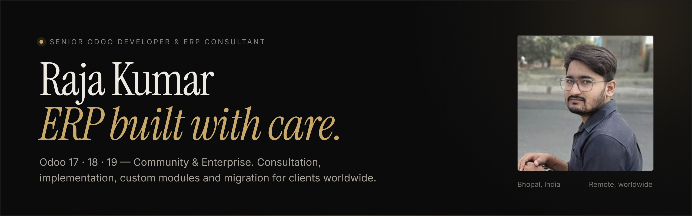

  

  
  
  
  

---

### About

I'm a **Senior Odoo Developer & ERP Consultant** who helps businesses get Odoo right: set up properly, built around how they actually work, and supported after go-live.

Over **10+ ERP projects** in India, the Middle East and Europe I've delivered **100+ custom Odoo modules**, from CRM automation and accounting reports to multi-company setups, customer portals and webshops. I work remotely with clients worldwide, directly and without agency overhead, typically at **up to 75% lower cost** than traditional ERP partners.

- **Now** — Senior Odoo Developer & ERP Administrator at **Strohm Energy**, running Odoo 19 Enterprise across a 7-company solar energy group
- **Building** — MYSTOVIO, a lead-to-project platform for solar installers, and an Odoo-native solar design & proposal system
- **Based in** — Bhopal, India · working in your time zone

---

### What I do

| | |
|:--|:--|
| **Odoo consultation** | Requirement analysis, process mapping and a clear rollout plan, Community or Enterprise |
| **ERP setup & implementation** | Sales, CRM, Inventory, Accounting, Manufacturing, HR, Projects, Website — single or multi-company |
| **Custom module development** | Python, OWL/JavaScript and QWeb modules that fit your exact workflow |
| **Data migration** | Zoho CRM & Books → Odoo, spreadsheets, legacy ERPs and version upgrades, with zero data loss |
| **Hosting & DevOps** | Odoo Online, Odoo.sh or your own server; staging, production and automated off-site backups |
| **Integrations & AI** | WhatsApp, Meta Lead Ads, payment gateways, Google Maps, IoT and Claude/MCP connected to Odoo |

---

### Selected work

| Project | What it does | Outcome |
|:--|:--|:--|
| **Meta Lead Ads & WhatsApp ingestion** | Event-driven webhooks with HMAC-SHA256 verification and an OWL chat view inside CRM | Lead capture under 2 seconds |
| **Zoho → Odoo 19 migration** | Field mapping, schema reconciliation and validation hooks | 100K+ records, zero data loss |
| **Odoo ↔ Claude MCP server** | Connects Odoo to Claude AI, self-hosted behind a Cloudflare Tunnel | AI assistant on live ERP data |
| **WiPay payment gateway** | Payment provider modules for Odoo 17 & 18 with webhook status sync | 4 currencies, live in production |
| **IoT inventory automation** | Barcode scanning, Bluetooth label printing and EAN-13 generation | −50% manual effort, −70% setup time |
| **Fleet booking & live tracking** | Route planning, driver assignment and WhatsApp confirmations in Odoo | End-to-end logistics automation |

---

### Toolkit

  
  
  
  
  
  
  
  
  
  
  
  

---

### Experience

| Period | Role |
|:--|:--|
| **2026 — Present** | Senior Odoo Developer & ERP Administrator · **Strohm Energy** · Belgium (hybrid / remote) |
| **Feb 2026 — 2026** | Senior Odoo Developer & Architect (SDE-II) · **AlignTogether Solutions** · Bhopal |
| **Nov 2024 — Feb 2026** | Odoo Developer · **Annapurna Tour & Travels** · Bhopal |

---

  <b>Planning an Odoo setup, migration or custom module?</b> 
  <a href="https://raja-portfolio-lyart.vercel.app/#contact">Start a conversation →</a>
  &nbsp;·&nbsp;
  <a href="mailto:rajakumar829891@gmail.com">rajakumar829891@gmail.com</a>

